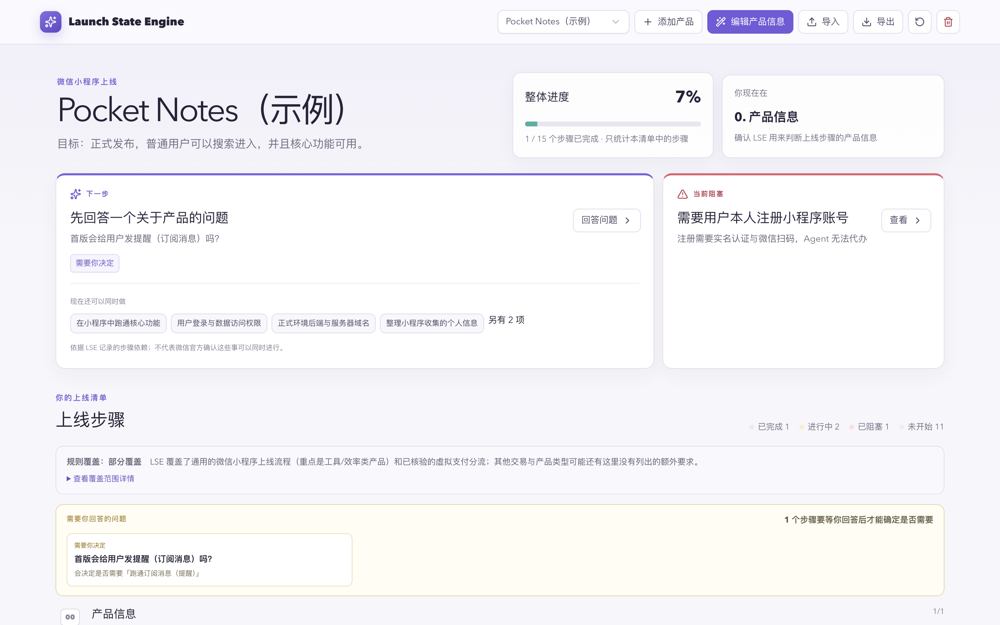
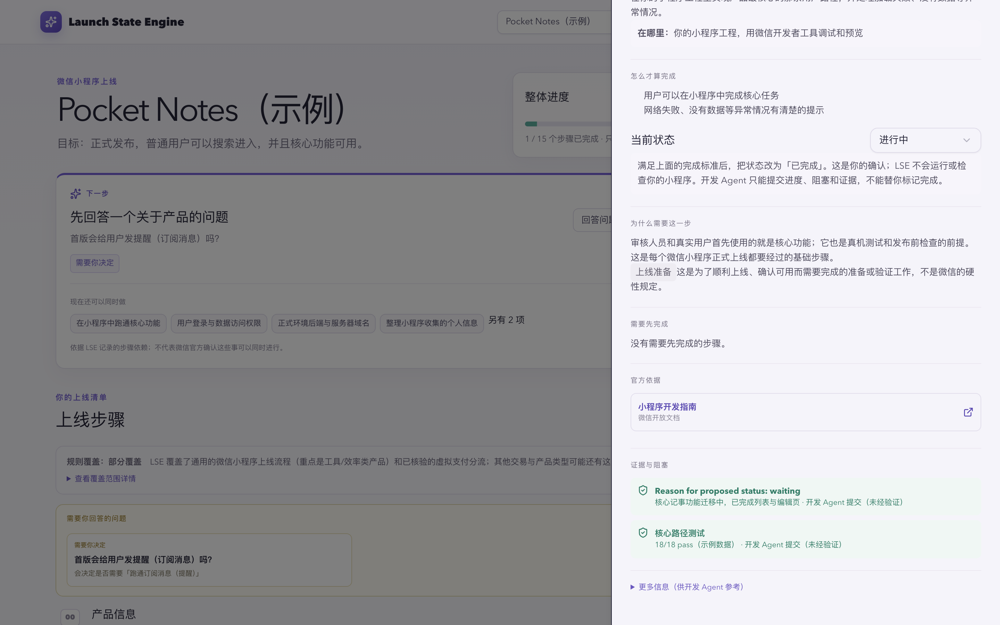

# Launch State Engine

把已有产品上线成微信小程序时，要做的事情分散在很多地方：注册账号、选择类目、备案、隐私保护指引、服务器域名、真机测试、提交审核……哪些步骤适用，取决于产品用了哪些能力；有些步骤只能由你本人完成（实名认证、扫码、后台操作）；如果用 Coding Agent 开发，它往往不知道整体进行到哪一步，也可能把"代码写完了"当成"这一步完成了"。

Launch State Engine（LSE）是一个在本机运行的上线状态工具。你描述产品事实，LSE 生成这个产品适用的上线清单，标出每一步的完成标准、依赖关系和官方依据，并持续告诉你：现在到哪了、下一步做什么、卡在哪里、哪些事可以同时做。

你在 Dashboard 里查看和确认进度；你的 Coding Agent 通过命令行读取同一份状态、提交进度和证据。步骤是否完成，始终由你确认。

> LSE 不写代码、不部署、不操作微信公众平台，也不提交审核。它不是微信官方工具，也不是完整的合规检查。清单进度 100% 不代表所有微信官方要求都已满足，也不保证能通过审核。

## 界面预览





截图来自隔离测试环境中真实运行的 LSE。产品「Pocket Notes（示例）」和其中的进度都是虚构数据。

## 核心能力

- **按产品生成清单**：用「是 / 否 / 待确认」描述产品事实。LSE 根据 Rule Registry 只生成适用的步骤，并说明哪些步骤因为什么不适用、哪些要等你回答问题后才能确定。待确认不会被当成「否」。
- **每一步都说清楚**：要做什么、在哪里做、怎么才算完成、为什么需要、依赖哪些步骤、对应的微信官方文档，以及区分官方要求与经验建议。
- **下一步与并行工作**：根据步骤依赖给出 Next Action、当前主阻塞，以及现在可以同时推进的事。
- **人和 Agent 共享状态**：Dashboard 和命令行读写同一份本地数据。Agent 可以提交进度、阻塞和证据，但不能把步骤标记为完成。
- **多个产品互不干扰**：在本机创建、切换、编辑、删除多个产品，各自的状态相互隔离。
- **覆盖边界可见**：Dashboard 和数据中都会显示当前规则覆盖到哪里、没有覆盖哪里。

## 快速开始：自己使用 Dashboard

需要 Node.js 22.13 或更高版本。

```bash
git clone https://github.com/ninagogogo1028/launch-state-engine.git
cd launch-state-engine
npm ci
npm run dev
```

启动后，在浏览器中打开终端输出的本地地址（`Local:` 一行）。

1. 首次启动没有任何产品。点击「添加我的产品」，填写已知的信息。不确定的保留「待确认」。
2. 提交后得到第一份上线清单。页面顶部是整体进度、下一步和当前阻塞。
3. 点开任意步骤，查看要求和完成标准。满足完成标准后，在「当前状态」里改为「已完成」。
4. 如果页面上出现「需要你回答的问题」，回答后清单会重新计算。已有的进度会保留。

不是每个「待确认」都会生成问题，只有会影响上线步骤的事实才会。具体见 [Product Context](docs/PRODUCT-CONTEXT.md#哪些-unknown-会生成待确认问题)。

Dashboard 的其他操作：

- **切换 / 添加产品**：顶部的产品选择器和「添加产品」。
- **编辑产品信息**：修改事实后清单重新计算，已有步骤的进度按步骤 ID 保留。
- **导出**：下载当前清单的 JSON，包含产品信息、各步骤状态、阻塞和证据。适合审查或留存记录。
- **导入**：只读取导出文件中的产品信息，用来更新当前产品；不会恢复步骤状态、阻塞或证据。导入的必须是同一个产品（相同 `productId`）。
- **清空步骤状态**（↺ 按钮）：清空当前产品的全部步骤状态和证据，保留产品信息。会先弹出确认。
- **删除产品**：删除前会列出影响范围并二次确认。删除后无法在 LSE 中恢复，需要保留进度请先按下文备份。

状态的含义：「未开始」「进行中」（数据中为 `waiting`：已开始推进，或在等待外部结果，例如审核）「已阻塞」「已完成」。

## 让 AI Agent 帮我安装和使用 LSE

LSE 不依赖特定的 Agent 或模型。任何能在终端运行命令的 Coding Agent，都可以通过 LSE 的命令行接口工作。

### 可以直接复制给 Agent 的指令

在你的产品仓库中打开 Claude Code、Codex 或其他 Coding Agent，把下面这段话发给它：

```text
请帮我用 Launch State Engine（LSE）管理这个产品的微信小程序上线进度。

1. 把 https://github.com/ninagogogo1028/launch-state-engine 克隆到当前项目之外的独立目录
   （例如 ~/tools/launch-state-engine），在那个目录运行 npm ci。需要 Node.js 22.13 或更高版本。
2. 阅读 LSE 的 README.md 和 docs/PRODUCT-CONTEXT.md，然后运行：
   node --experimental-strip-types <LSE 目录>/scripts/launch-state.cli.ts help
3. 运行 cases 查看是否已有我的产品。如果没有，根据这个项目的代码整理一份 Product Context
   草稿，先交给我确认。我没有明确回答的事实保留 "unknown"。确认后用 case-create 创建。
4. 运行 status 和 next，告诉我当前进度、下一步和阻塞，并告诉我怎样打开 Dashboard
   （在 LSE 目录运行 npm run dev）。
5. 之后在开发过程中，用 propose-status、propose-evidence、propose-blocker 记录进度和证据。

规则：
- 不要把任何步骤标记为完成。完成由我在 Dashboard 中确认。
- 遇到 owner 为 user 或 policy 为 stop_and_ask 的问题，停下来问我。不要替我决定，也不要把 unknown 改成 false。
- 没有我的明确要求，不要运行 reset，也不要用 context-set 修改我已经回答过的事实。
- 不要把 LSE 的目录或数据放进这个项目。
```

关于这段指令，请注意：

- **已验证**：CLI 可以在任意目录调用，数据始终写入 LSE 仓库，这部分有自动化测试覆盖。在此前的一次接入测试中，一个全新的 Claude 会话只按照早期版本的 README，在 LSE 仓库中完成了安装、创建 Launch Case 和提交进度，并在 Dashboard 中看到了同一份状态。那次测试发现的跨目录问题已经修复。
- **未验证**：这段指令本身还没有在 Claude Code、Codex 或其他 Agent 中逐一实测。Agent 能否自行完成克隆和安装、能否在后台持续运行 Dashboard，取决于具体 Agent 的能力和权限设置。Dashboard 建议由你自己在终端运行 `npm run dev`。

### 跨项目使用：数据存在哪里

LSE 的数据始终放在 LSE 仓库的 `public/flows/` 中，与 Agent 当前在哪个目录工作无关。CLI 按以下顺序确定使用哪个 LSE 仓库：

1. 命令行参数 `--root <LSE 目录>`
2. 环境变量 `LSE_ROOT`
3. CLI 文件所在的 LSE 仓库（默认）

所以在产品仓库中，直接用完整路径调用 LSE 仓库里的 CLI 即可：

```bash
node --experimental-strip-types ~/tools/launch-state-engine/scripts/launch-state.cli.ts status
```

在 LSE 仓库根目录中，也可以用 `npm run launch-state -- status`。

指定的目录必须是 LSE 仓库根目录（`package.json` 的 `name` 为 `launch-state-engine`），否则 CLI 直接报错退出，不会读取或写入任何数据。`status` 和 `cases` 的输出中有 `lseRoot` 字段，显示实际使用的仓库。`case-create`、`context-set`、`submit` 的文件参数如果是相对路径，按当前工作目录解析，Agent 可以直接引用产品仓库中的文件。

### Agent 的工作流程

以下用 `lse` 代表上面任意一种调用方式。

1. **创建 Launch Case**：复制 [`examples/product-context.json`](examples/product-context.json)，填写 `productId`、`name` 和已知事实。字段和可选值见 [Product Context](docs/PRODUCT-CONTEXT.md)。

   ```bash
   lse case-create my-product.json
   ```

   如果你已经在 Dashboard 中添加过产品，跳过这一步：用 `lse cases` 查看，用 `lse case-switch <caseId>` 切换。

2. **读取状态和下一步**：

   ```bash
   lse status
   lse next
   lse parallel        # 现在可以同时开始的工作
   lse node <nodeId>   # 某一步的要求、依赖和完成标准
   ```

3. **遇到产品决策，交还给你**：`next` 返回 `kind: "product_decision"`，或 `undetermined` 列出的问题，都带有 `owner: "user"` 和 `policy: "stop_and_ask"`。Agent 应当询问你。你回答后，Agent 更新事实并重新读取：

   ```bash
   lse undetermined
   lse context-set my-product.json   # 只能更新当前产品（相同 productId）
   lse next
   ```

4. **提交进度、证据和阻塞**：

   ```bash
   lse propose-status <nodeId> waiting "已开始迁移核心功能"
   lse propose-evidence <nodeId> <type> <label> <value>
   lse propose-blocker <nodeId> <summary> <diagnosis> <resolution>
   lse submit payload.json   # 一次提交多个步骤，格式见 lse help
   ```

   `propose-status` 的第三个参数（原因）可选，会作为一条证据记录在同一步骤上。

5. **请你确认完成**：步骤满足完成标准后，Agent 应请你在 Dashboard 中核对证据并确认。Dashboard 在窗口重新获得焦点时重新读取数据，不会实时推送。

完整命令见 `lse help`。

## 人类与 Agent 的协作边界

| | 你（Dashboard） | Agent（命令行） |
|---|---|---|
| 把步骤标记为「已完成」 | 可以 | 不可以 |
| 提议「未开始 / 进行中 / 已阻塞」 | 可以 | 可以 |
| 提交证据和阻塞 | — | 可以，证据标记为「开发 Agent 提交（未经验证）」 |
| 回答产品决策问题 | 可以 | 不可以，应当询问你 |
| 创建、切换产品，更新产品事实 | 可以 | 可以（`case-create`、`case-switch`、`context-set`） |
| 清空当前产品的步骤状态 | 可以（会先确认） | 可以（`reset`，不会确认） |
| 删除产品 | 可以（会二次确认） | 命令行没有删除命令 |

需要特别说明的几点：

- `reset` 会清空当前产品的全部步骤状态和证据，**包括你已确认的完成**。上面的 Agent 指令要求它不经你同意不得运行。
- 你确认的状态优先于 Agent 的提议：Agent 后来提交的状态不会覆盖你的确认。
- LSE 不会运行或检查你的小程序工程。LSE 自己的测试和构建结果，不会让你的任何上线步骤变成完成。
- 以上是接口约定，不是安全边界。数据是本机上的普通 JSON 文件，开发服务器的接口没有认证。能直接修改文件或调用接口的程序可以绕过这些约定。请只在可信设备上运行。

## 数据存储、备份与隐私

所有数据保存在 LSE 仓库中：

```text
public/flows/launch-state.json              当前选中的产品
public/flows/launch-cases/<caseId>.json     每个产品的完整记录
```

- 数据包含产品信息、步骤状态、阻塞和证据，请按用户数据对待。
- `public/flows/` 已被 Git 忽略，`npm run build` 也会把它排除在构建产物之外。
- LSE 不需要账号，没有云同步，也不调用任何模型 API。Dashboard 页面只请求本机开发服务器的接口，命令行只读写本地文件；步骤详情中的官方文档链接在你点击时才会打开。
- 不要把真实的 case 文件贴到公开 issue、日志或 Git 仓库中。

备份与恢复：

- **完整备份**：复制 `public/flows/launch-cases/<caseId>.json`。
- **完整恢复**：把备份文件放回 `public/flows/launch-cases/`，然后在 Dashboard 中切换到该产品，或运行 `lse case-switch <caseId>`。
- **Dashboard 的「导出」不能用于恢复进度**，「导入」只恢复产品信息。

## 当前支持范围与规则覆盖

V0.1 只支持微信小程序这一个上线目标，规则覆盖等级为 **partial（部分覆盖）**：

- **已覆盖**：通用的微信小程序上线流程，以及登录、云端数据、隐私、订阅消息、文件 / 图片、剪切板、位置、UGC 和虚拟支付等条件路径。这些规则人工整理自微信官方文档，规则重点验证过工具 / 效率类产品。
- **尚未完整覆盖**：普通小程序支付、实物订单与履约、广告、抽佣、捐赠，以及游戏、电商、教育、内容等类型产品的专项要求。
- **没有生成的步骤，不代表没有要求。**
- 产品信息中的「产品形态」只是 LSE 内部的分类，不是微信官方服务类目。正式类目和主体资质，请在微信公众平台按实际业务核验。
- 规则不会自动从微信官方同步更新。每条规则记录了最后核验日期。

完整边界见 [Coverage Matrix](docs/COVERAGE-MATRIX.md)，规则来源和维护方式见 [Rule Registry](docs/RULE-REGISTRY.md)。

V0.1 是单用户、本地运行的版本，不包含账号系统、云同步、团队协作、微信后台连接、规则自动抓取、Agent 编排或自动发布。

## 开发者文档与测试

| 文档 | 内容 |
|---|---|
| [Architecture](docs/ARCHITECTURE.md) | 整体结构、写入通道与验证语义 |
| [State Model](docs/STATE-MODEL.md) | Flow、节点、Launch Truth 与状态定义 |
| [Product Context](docs/PRODUCT-CONTEXT.md) | 字段、可选值，以及哪些 unknown 会生成问题 |
| [Rule Registry](docs/RULE-REGISTRY.md) | 规则来源、结构与维护方式 |
| [Coverage Matrix](docs/COVERAGE-MATRIX.md) | 已验证、部分覆盖与未验证的领域 |
| [Research](docs/RESEARCH.md) | 生态调研与复用决策 |

```bash
npm test            # 回归测试
npm run fixtures    # 用虚构示例产品编译清单
npm run typecheck
npm run lint
npm run build
```

目前在 macOS + Node.js 25 上验证过全新安装与上述全部检查，全新安装（`npm ci`）另在 npm 10 和 11 上验证过。Windows、Linux 和 Node.js 22 尚未实测。

主要目录：

```text
app/                 Dashboard
build/               本地 Launch Truth API 插件与构建入口
components/ui/       UI 组件
docs/                文档与截图
examples/            Product Context 模板
lib/flow-engine/     Rule Registry、节点目录和清单编译
lib/launch-store*    本地状态读写与隔离
scripts/             命令行与 fixture runner
tests/               回归测试
```

## License

[MIT](LICENSE) © 2026 Nina Jia

仓库中基于 shadcn/ui 的 UI 组件和样式，其 MIT 版权声明保留在 [`vendor/shadcn-tailwind-4.13.0.LICENSE.md`](vendor/shadcn-tailwind-4.13.0.LICENSE.md)。安装的依赖各自受其上游许可证约束。
